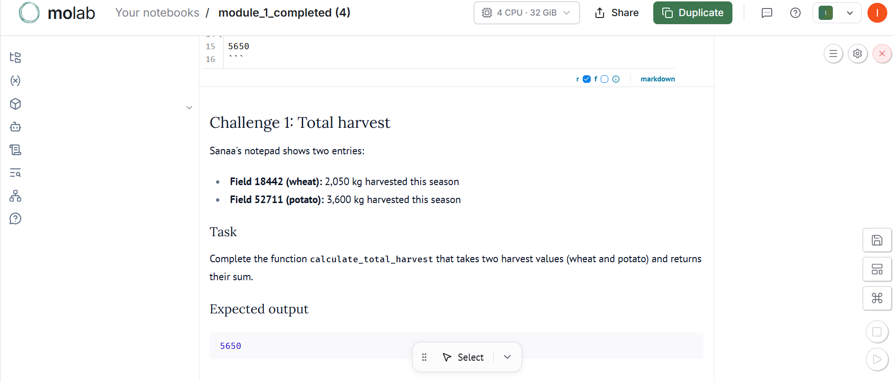
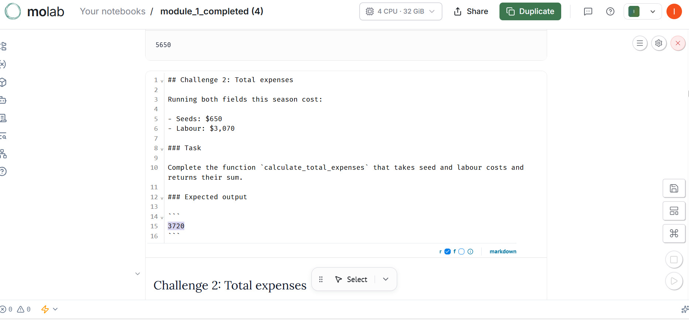
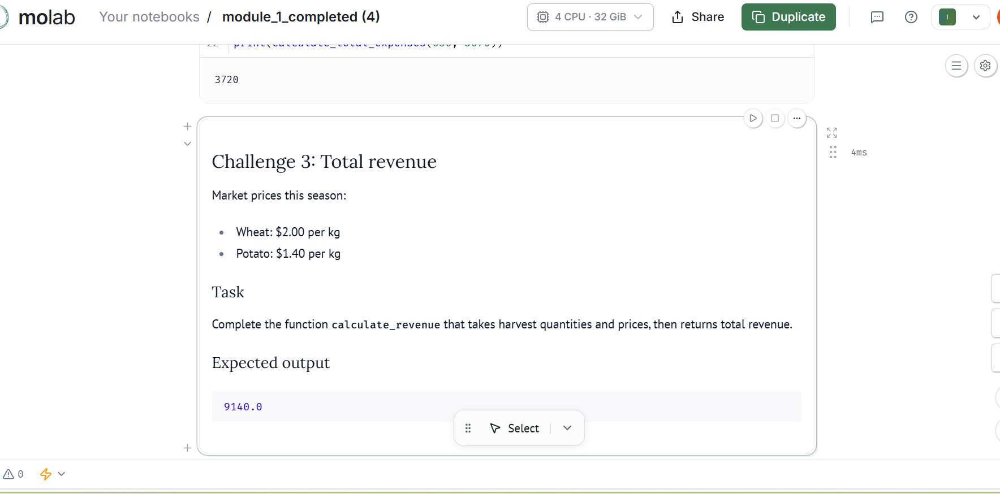
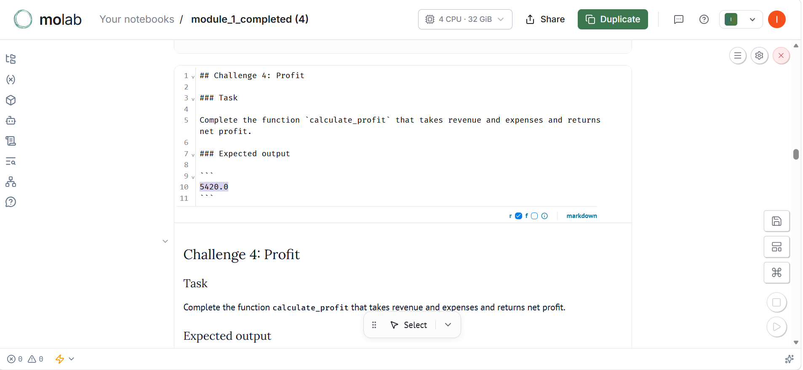
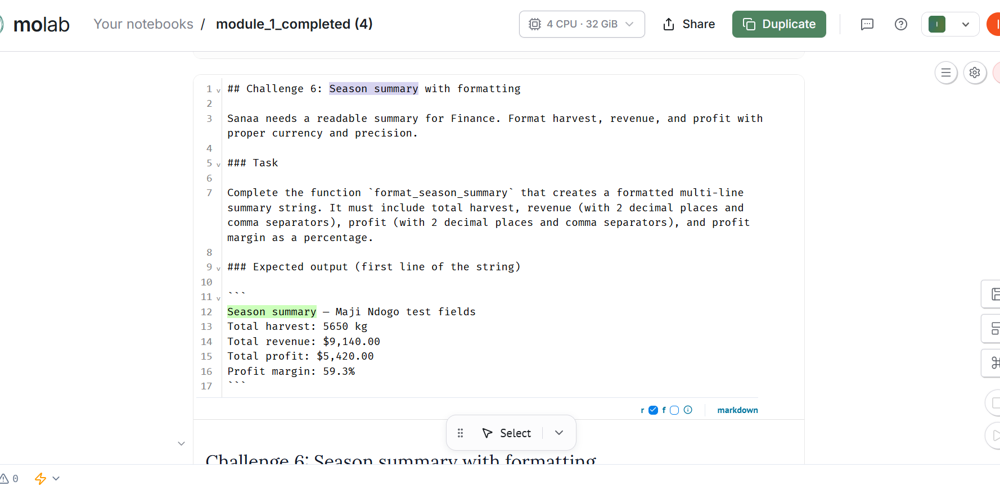
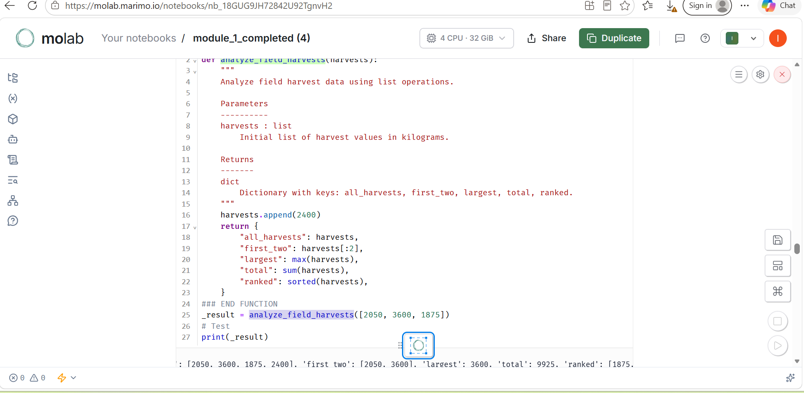

# Farm Harvest Management — Python Foundations

## 1. The Business Problem

Agricultural businesses need reliable ways to record crop harvests, calculate expenses, track revenue, and evaluate profitability. Managing these records consistently helps farmers understand their production and make better decisions.

This project uses Python fundamentals to organize farm data and perform basic harvest and financial analysis.

## 2. The Tech Stack

- **Python**
- Functions and reusable code
- Lists, tuples, sets, and dictionaries
- String cleaning and data validation
- Basic calculations and formatted summaries

## 3. The Deliverable

The project implements reusable Python functions to:

- Create and look up field harvest records.
- Clean and standardize crop names.
- Calculate total harvest, revenue, expenses, and profit.
- Count unique crops.
- Analyze harvest records and generate a season summary.

## 4. The “So What?”

These functions demonstrate how simple Python tools can make agricultural record-keeping more organized and reduce repetitive calculations. The same principles can support more advanced agricultural data analysis in later projects.
## 5. Project Evidence

The screenshots below show examples of the Python functions running and their outputs.

### Total Harvest

### Total Expenses

### Revenue

### Profit

### Season Summary

### Harvest List Analysis

